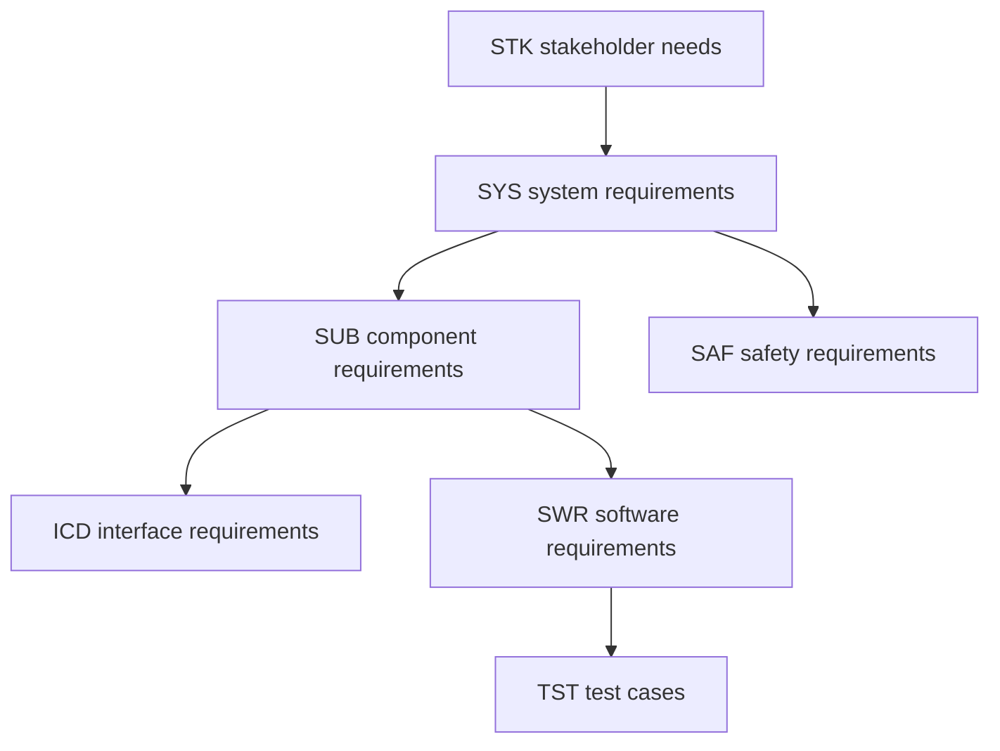

# ADAS Camera Processing and Safety Monitoring System: MBSE and Requirements Engineering

A hands-on systems engineering portfolio project. It builds a practical requirements model for a camera-based pedestrian detection and AEB (automatic emergency braking) function, using a Capella system model and git-based requirements with end-to-end traceability.

German title: ADAS Kamera Verarbeitungs- und Sicherheitsüberwachungssystem, MBSE und Anforderungsengineering.

## What this project covers

- Requirements model with stakeholder, system, component, software, safety, interface and verification requirements
- Requirement decomposition and allocation to the Capella model
- End-to-end traceability from stakeholder need to software requirement to test case
- Verification coverage analysis (traceability matrix and gap report)
- Baseline management with git tags

## Scope

System of interest: the camera-based perception and safety monitoring chain (camera, ISP, SoC, ECU) that detects pedestrians and issues an AEB request. Out of scope: brake actuation, vehicle dynamics and maps. The full statement is in [docs/scope.md](docs/scope.md), and the operating scenarios SC-01 to SC-04 are in [docs/scenarios.md](docs/scenarios.md).

## Tools

| Tool | Used for |
|---|---|
| Capella 7.1.0 (Arcadia method) | Operational analysis, system analysis, logical architecture |
| Doorstop (Python, YAML files in git) | Requirements, links and review status |
| Python scripts | Generating requirement items, traceability and coverage report |
| git | Version control and baselines (tags) |

## How the pieces fit together

Capella holds the structure of the system: who is in the environment, what the system does and which component does it. Doorstop holds the text of the requirements. The two are connected by names: requirements carry the attributes `component`, `capella_ref` and `software_unit`, which match element names in the Capella model.



| Layer | Capella | Doorstop |
|---|---|---|
| Needs | none | STK |
| Operational analysis | OAB Context (actors, capabilities) | none |
| System analysis | SAB Context and SDFB Context (system, actors, functions, exchanges) | SYS |
| Logical architecture | LAB Context (components, function allocation, component exchanges) | SUB, SAF, ICD |
| Software | none | SWR |
| Verification | none | TST |

Safety requirements (SAF) are referenced from software requirements through the attribute `saf_ref`, because SAF and SUB are sibling documents.

## Repository structure

```
adas-camera-mbse/
  model/      Capella project ADAS_Camera_Safety
  reqs/       Doorstop documents: stk, sys, sub, saf, icd, swr, tst
  docs/       scope.md, scenarios.md, images/
  reports/    trace_matrix.csv, coverage_report.md
  scripts/    helper scripts (see below)
```

## Reproduce

Requirements and reports:

```
python -m venv .venv
.venv\Scripts\activate
pip install doorstop
doorstop
python scripts/trace_report.py
```

`doorstop` validates the requirement tree. `trace_report.py` writes `reports/trace_matrix.csv` and `reports/coverage_report.md`.

Model: start Capella 7.1.0, choose the `model` folder as workspace and open the project `ADAS_Camera_Safety`.

## Scripts

| Script | Purpose |
|---|---|
| `enrich_stk.py` | Adds rationale, source, priority, ASIL and verification method to the stakeholder needs |
| `create_sys.py`, `create_sub_saf_icd.py`, `create_swr.py`, `create_tst.py` | One-time generators for the requirement documents. They refuse to run again when items already exist. |
| `create_gap_closure.py` | Adds the camera and ISP software requirements and tests found missing by the coverage analysis |
| `trace_report.py` | Traceability matrix and coverage report |

## Baselines

Baselines are git tags named `baseline-0.1`, `baseline-0.2` and so on. Compare two baselines with:

```
git diff baseline-0.1 baseline-0.2 -- reqs
```

## Limitations

- ASIL values are assumed. They are not the result of a hazard analysis and risk assessment (HARA).
- Values marked TBD (thresholds, latencies, frame rates) are open points by design. The coverage report counts them.
- The safe state in SAF-002 (fail-silent with driver notification) is an assumption.
- All test cases are planned. None has been executed, and the result fields are empty.
- The link between Capella and Doorstop is by name only and is not checked automatically. A production setup would use a tool link (for example ReqIF or a requirements tool).
- No real vehicle data is used.

## Standards referenced

ISO 26262, ISO 21448 (SOTIF), ASPICE SYS.1 to SYS.5 and SWE.1 to SWE.6. The project is inspired by these standards and does not claim compliance.

## Author

Sanika Kshire ([github.com/kshiresanika](https://github.com/kshiresanika))
